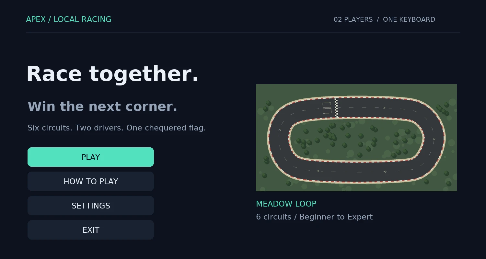
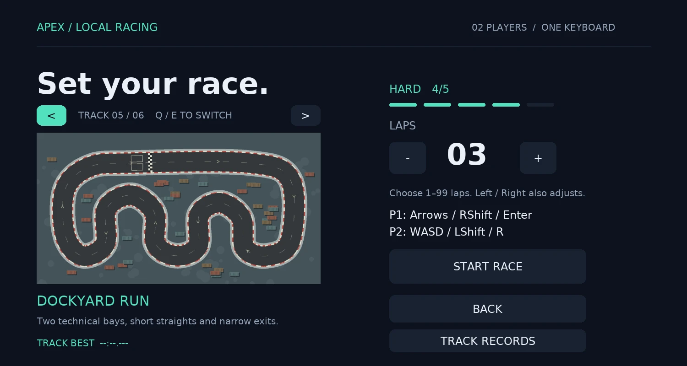
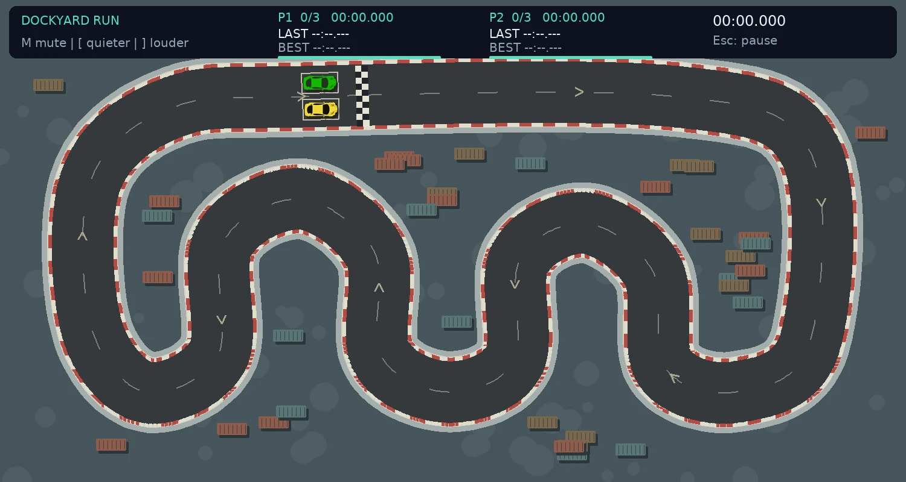

# APEX / Local Racing

A local two-player, top-down arcade racing game built with Python and Pygame.
Race on six circuits, use rechargeable boost, trade bumper-to-bumper contact,
and compete for saved lap and race records on one keyboard.

## Download and play

[](https://github.com/ItsJensen316/2D-Multiplayer-Racing/releases/latest/download/ApexRacing.exe)

Download **ApexRacing.exe**, save it anywhere convenient, and double-click to play.
No installation, Python, or separate asset files are required on compatible Windows PCs.
Both players use the same keyboard.



## Features

- Six circuits ordered from beginner to expert.
- Two players on one keyboard; configurable races from 1 to 99 laps.
- Shared fixed-step physics, acceleration, braking, reversing and steering.
- Car-to-car collisions, road boundaries and wall sliding.
- Rechargeable boost with separate meters for each player.
- Safe recovery with a time penalty and cooldown.
- Ordered checkpoints and direction-aware lap counting.
- Current, previous and best lap times, plus race results.
- Saved track records, including player-slot bests and race distances.
- Synthesized engine loops with pitch crossfades, tyre/brake sounds, impacts,
  countdown beeps, lap cues and a finish jingle. No audio downloads needed.
- Fading tyre marks, collision sparks and a start indicator.
- Pause, restart, track selection, results and audio settings.
- Resizable window, mouse/keyboard menus and saved volume/mute preferences.
- Silent play when an audio device is unavailable.

This is local multiplayer, with both players using the same computer.

## Screenshots

### Track selection



### Racing



## Controls

### Driving

| Action | Player 1 | Player 2 |
| --- | --- | --- |
| Accelerate | Up arrow | W |
| Brake / reverse | Down arrow | S |
| Steer left / right | Left / Right arrows | A / D |
| Boost while accelerating | Hold Right Shift | Hold Left Shift |
| Recover | Enter | R |

### Menus and audio

| Action | Control |
| --- | --- |
| Pause / resume; back from other screens | Esc |
| Select a menu button | Tab, Shift+Tab, Up / Down |
| Activate selected button | Enter / Space, or mouse click |
| Change track on Race Setup | Q / E, or `<` / `>` buttons |
| Adjust laps on Race Setup | Left / Right arrows, or minus / plus buttons |
| Toggle mute | M |
| Lower volume | `[` |
| Raise volume | `]` |

In a race, Enter recovers Player 1; in menus, it activates a button.

## Circuits

| Circuit | Difficulty | Route |
| --- | --- | --- |
| Meadow Loop | 1/5 — Beginner | Wide lanes and sweeping corners |
| Club Circuit | 2/5 — Easy | Fast outer loop with an infield detour |
| Quarry Bend | 3/5 — Intermediate | Deep horseshoe and tightening bends |
| Classic Circuit | 3/5 — Intermediate | Long straight and a tight infield bend |
| Dockyard Run | 4/5 — Hard | Narrow bays and short straights |
| Ridge Switchbacks | 5/5 — Expert | Repeated hairpins and an S-bend |

## Race rules

Follow the arrows and pass every sector in order before crossing the finish line.
The race ends when a player completes the selected number of laps. Finishes on
the same simulation step count as a dead heat. A player who has not finished when
the winner crosses is marked DNF; completed laps can still qualify for lap records.

Boost lasts up to two seconds from a full charge and refills when released. A full
refill takes about 6.25 seconds. After emptying the meter, release and refill at
least 30% before boosting again. Boost is unavailable while braking or reversing.

Recovery places the car behind its last passed checkpoint, facing the route. It
only succeeds if there is a safe, unoccupied position. A successful recovery causes
a two-second stop while the clock continues and has a five-second cooldown. It
does not refill boost or advance checkpoints. Pausing stops the race and penalty
clocks; restarting resets the race.

## Records and settings

Track records and audio preferences are saved automatically outside the game folder:

```text
Windows: %APPDATA%\ApexRacing\records.json
Linux:   ~/.local/share/apex-racing/records.json
```

On Windows, press **Win+R**, enter `%APPDATA%\ApexRacing`, and press Enter
to open the save folder. This normally resolves to
`C:\Users\<username>\AppData\Roaming\ApexRacing`.

`records.json` stores best lap times, race records, player-slot bests, volume
and mute preferences. It stores records rather than a complete history of every lap.
Saves belong to the current computer and Windows user; they do not travel with the
executable or sync online. To transfer them, close the game and copy `records.json`
to the same save folder on the other PC. Back it up before replacing an existing save.
Deleting this file while the game is closed resets records and audio preferences.

`XDG_DATA_HOME` is respected on Linux. `APEX_RACING_DATA_DIR` can override the
save location. Replacing the executable does not remove these records.

Race records are separated by track and lap count. P1/P2 refer to
keyboard slots, not named accounts. The first lap includes the standing start;
later laps are flying laps. Pausing does not add to lap times.

## Run from source

Requires Python and Pygame 2.6.1. From the project directory:

```bash
python -m pip install -r requirements.txt
python main.py
```

## Architecture

| Module | Responsibility |
| --- | --- |
| `racing/app.py` | Screens, input, HUD and race lifecycle |
| `racing/driver.py` | Fixed-step physics, collisions, boost and recovery |
| `racing/tracks.py` | Track rendering, road masks and checkpoints |
| `racing/records.py` | Persistent records and audio settings |
| `racing/audio.py` | Synthesized engine loops and sound effects |
| `racing/effects.py` | Skid marks and collision sparks |

Circuit layouts are defined in `data/tracks/circuits.json`.
Physics runs at 120 simulation steps per second. Engine sounds use precomputed
waveforms with pitch crossfades; no external audio assets are required.

## Tests

```bash
python -m unittest discover -s tests -v
```

37 automated checks cover tracks, physics, timing, records, boost, recovery and audio.
